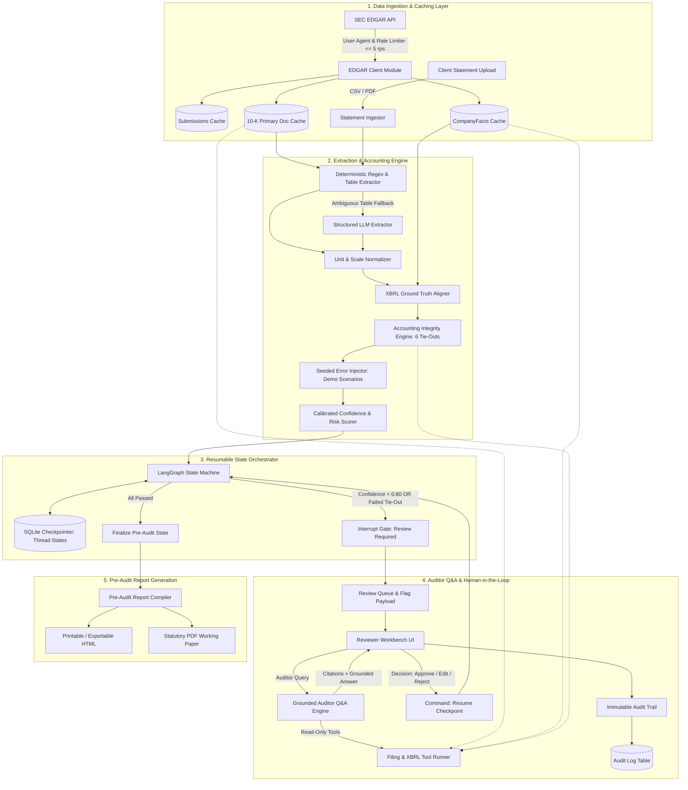

# Moneta System Architecture & Technical Specification

**Author:** Staff Engineer  
**Product:** Moneta — Human-in-the-Loop Financial Filing Pre-Audit Agent  
**Version:** 1.0 (Production Specification)

---

## 1. High-Level System Architecture

Moneta is architected as an asynchronous, state-machine driven pre-audit engine with strict double-entry accounting integrity, human-in-the-loop pause/resume semantics, read-only grounded retrieval, and an immutable audit trail.



---

## 2. LangGraph State Machine & Node Architecture

### State Definition: `MonetaAuditState`
```python
from typing import TypedDict, List, Dict, Any, Optional

class ExtractedMetric(TypedDict):
    concept: str
    value: float
    raw_text: str
    unit: str
    scale: str
    period_end: str
    evidence_snippet: str
    method: str  # 'regex', 'html_table', 'pdfplumber', 'llm_fallback'
    is_derived: bool

class TieOutResult(TypedDict):
    tie_out_name: str
    status: str  # 'PASS', 'FAIL', 'WARN', 'INCONCLUSIVE_DERIVED'
    expected_value: float
    actual_value: float
    delta: float
    formula: str
    contributing_items: List[str]
    materiality_impact: str

class MonetaAuditState(TypedDict):
    session_id: str
    thread_id: str
    company_ticker: str
    cik: str
    company_name: str
    fiscal_year: int
    form_type: str
    primary_doc_url: str
    is_demo_seeded: bool
    seed_scenario: Optional[str]
    
    # Financial data
    metrics: Dict[str, ExtractedMetric]
    xbrl_ground_truth: Dict[str, Any]
    tie_outs: Dict[str, TieOutResult]
    confidence_scores: Dict[str, float]
    
    # Human-in-the-loop workflow
    pending_flags: List[str]
    current_flag: Optional[str]
    human_decisions: List[Dict[str, Any]]
    audit_trail: List[Dict[str, Any]]
    
    # Final Output
    report_ready: bool
    report_data: Optional[Dict[str, Any]]
```

### Graph Nodes & Transition Logic
1. **`node_ingest`**: Fetches SEC Submissions JSON, downloads/caches the primary 10-K document and `companyfacts.json` (or parses uploaded file).
2. **`node_extract`**: Runs deterministic extraction for core metrics (Revenue, Liabilities, Net Income, Equity, Assets, Cash Flow, Gross Profit, Operating Income). Captures exact source context windows.
3. **`node_align_xbrl`**: Resolves XBRL tags using ordered fallback rules, matches fiscal periods using `form=10-K`, `fp=FY`, and `fy`, and standardizes scales.
4. **`node_accounting_integrity`**: Executes the 6 mandatory tie-outs:
   - Balance Sheet Identity ($A = L + E$)
   - Retained Earnings Roll-Forward (P&L to Balance Sheet bridge)
   - Net Income (P&L vs Cash Flow Statement)
   - Ending Cash (Cash Flow Statement vs Balance Sheet Cash)
   - Gross Profit ($Revenue - COGS$)
   - Segment Breakdown ($\sum \text{Segments} = \text{Consolidated}$)
   - Injects seeded errors if `is_demo_seeded=True`.
5. **`node_score_confidence`**: Evaluates extraction method, XBRL concordance, tie-out passes, and materiality to compute calibrated confidence scores ($0.00 - 1.00$).
6. **`node_triage_flags`**: Compiles `pending_flags` list (any metric with confidence $< 0.80$ or failed tie-out). If empty, routes to `node_generate_report`.
7. **`node_human_review`**:
   - Pops the next flag from `pending_flags`.
   - Calls LangGraph `interrupt({"flag": flag_payload, "metric": metric_data, "evidence": snippet, "tie_out": tie_out_data})`.
   - Halts graph execution and saves state in SQLite Checkpointer.
   - Upon resumption with `Command(resume=decision_payload)`:
     - Applies human action (`approve`, `edit`, or `reject`).
     - Appends entry to `audit_trail` and writes to `audit_log` table.
     - Loops back to `node_triage_flags` until all flags are resolved.
8. **`node_generate_report`**: Compiles formal Pre-Audit Working Paper Report data model.

---

## 3. Database Schema (Extended)

Implemented in SQLite via SQLAlchemy 2.0:

```sql
-- Companies Registry
CREATE TABLE companies (
    id INTEGER PRIMARY KEY AUTOINCREMENT,
    ticker VARCHAR(10) UNIQUE NOT NULL,
    cik VARCHAR(10) NOT NULL,
    name VARCHAR(255) NOT NULL,
    sic VARCHAR(10),
    fiscal_year_end VARCHAR(10),
    created_at TIMESTAMP DEFAULT CURRENT_TIMESTAMP
);

-- Filings Metadata
CREATE TABLE filings (
    id INTEGER PRIMARY KEY AUTOINCREMENT,
    company_id INTEGER NOT NULL REFERENCES companies(id),
    accession_number VARCHAR(25) UNIQUE NOT NULL,
    form VARCHAR(10) NOT NULL,
    filing_date DATE NOT NULL,
    report_date DATE NOT NULL,
    primary_document VARCHAR(255) NOT NULL,
    document_url VARCHAR(500) NOT NULL,
    local_cache_path VARCHAR(500),
    created_at TIMESTAMP DEFAULT CURRENT_TIMESTAMP
);

-- Extracted Metrics
CREATE TABLE extracted_metrics (
    id INTEGER PRIMARY KEY AUTOINCREMENT,
    filing_id INTEGER NOT NULL REFERENCES filings(id),
    concept VARCHAR(100) NOT NULL,
    extracted_value NUMERIC(18, 2) NOT NULL,
    raw_text VARCHAR(100),
    unit VARCHAR(10) DEFAULT 'USD',
    scale VARCHAR(20) DEFAULT 'exact',
    period_start DATE,
    period_end DATE NOT NULL,
    method VARCHAR(50) NOT NULL,
    is_derived BOOLEAN DEFAULT FALSE,
    evidence_snippet TEXT NOT NULL,
    evidence_page INTEGER,
    xbrl_tag VARCHAR(100),
    xbrl_ground_truth NUMERIC(18, 2),
    confidence_score NUMERIC(5, 4) NOT NULL,
    status VARCHAR(50) NOT NULL, -- 'AUTO_APPROVED', 'FLAGGED', 'VERIFIED', 'EDITED', 'REJECTED'
    created_at TIMESTAMP DEFAULT CURRENT_TIMESTAMP
);

-- Accounting Tie-Out Results
CREATE TABLE tie_out_results (
    id INTEGER PRIMARY KEY AUTOINCREMENT,
    filing_id INTEGER NOT NULL REFERENCES filings(id),
    tie_out_name VARCHAR(100) NOT NULL,
    status VARCHAR(30) NOT NULL, -- 'PASS', 'FAIL', 'WARN', 'INCONCLUSIVE_DERIVED'
    expected_value NUMERIC(18, 2),
    actual_value NUMERIC(18, 2),
    delta NUMERIC(18, 2),
    formula VARCHAR(255) NOT NULL,
    contributing_items TEXT, -- JSON array of line items
    materiality_assessment VARCHAR(50),
    created_at TIMESTAMP DEFAULT CURRENT_TIMESTAMP
);

-- Materiality Thresholds Configuration
CREATE TABLE materiality_thresholds (
    id INTEGER PRIMARY KEY AUTOINCREMENT,
    filing_id INTEGER NOT NULL REFERENCES filings(id),
    pre_tax_income NUMERIC(18, 2),
    total_revenue NUMERIC(18, 2),
    total_assets NUMERIC(18, 2),
    planning_materiality NUMERIC(18, 2) NOT NULL, -- 5% of Pre-Tax Income
    tolerable_misstatement NUMERIC(18, 2) NOT NULL, -- 50-75% of PM
    variance_percentage_threshold NUMERIC(5, 2) DEFAULT 30.0,
    created_at TIMESTAMP DEFAULT CURRENT_TIMESTAMP
);

-- Grounded Auditor Queries (Q&A Loop)
CREATE TABLE auditor_queries (
    id INTEGER PRIMARY KEY AUTOINCREMENT,
    filing_id INTEGER NOT NULL REFERENCES filings(id),
    metric_concept VARCHAR(100),
    reviewer_id VARCHAR(100) NOT NULL,
    query_text TEXT NOT NULL,
    response_text TEXT NOT NULL,
    tools_invoked TEXT, -- JSON array of {tool: str, args: dict}
    citations TEXT, -- JSON array of {section: str, page: int, footnote: str}
    created_at TIMESTAMP DEFAULT CURRENT_TIMESTAMP
);

-- Immutable Append-Only Audit Trail
CREATE TABLE audit_log (
    id INTEGER PRIMARY KEY AUTOINCREMENT,
    filing_id INTEGER NOT NULL REFERENCES filings(id),
    event_type VARCHAR(50) NOT NULL, -- 'SYSTEM_EXTRACTION', 'AUTO_APPROVE', 'ESCALATION', 'HUMAN_APPROVE', 'HUMAN_EDIT', 'HUMAN_REJECT'
    metric_concept VARCHAR(100),
    original_value NUMERIC(18, 2),
    new_value NUMERIC(18, 2),
    reviewer_id VARCHAR(100) NOT NULL,
    justification TEXT,
    state_hash VARCHAR(64) NOT NULL, -- SHA-256 integrity hash
    timestamp TIMESTAMP DEFAULT CURRENT_TIMESTAMP
);
```

---

## 4. FastAPI REST API Contracts

### Endpoints
1. `GET /api/health` -> Health check, DB connectivity, SEC rate limiter state.
2. `GET /api/companies` -> List benchmark companies (AAPL, MSFT, TSLA, IBM, GOOG).
3. `POST /api/audit/session` -> Initialize audit run:
   ```json
   {
     "ticker": "AAPL",
     "fiscal_year": 2024,
     "seed_error": false,
     "seed_scenario": null
   }
   ```
4. `GET /api/audit/{session_id}/state` -> Current LangGraph execution state, ledger metrics, tie-outs.
5. `GET /api/audit/{session_id}/flags` -> List of active escalations requiring human review.
6. `POST /api/audit/{session_id}/query` -> Auditor <-> LLM Q&A turn:
   ```json
   {
     "flag_id": "METRIC_LIABILITIES",
     "query": "Which footnote explains the $1.5B variance in other liabilities?"
   }
   ```
7. `POST /api/audit/{session_id}/decision` -> Submit auditor decision and resume graph:
   ```json
   {
     "flag_id": "METRIC_LIABILITIES",
     "decision": "edit",
     "new_value": 152000000000,
     "justification": "Restated per Note 8 debt obligations reclassification",
     "reviewer": "Sarah Jenkins, CPA"
   }
   ```
8. `GET /api/audit/{session_id}/report` -> Complete structured JSON and rendered HTML of Pre-Audit Report.
9. `GET /api/audit/{session_id}/audit-trail` -> Cryptographically hashed chronological audit log.

---

## 5. Read-Only LLM Tools for Auditor Q&A

During flag review, the LLM is restricted exclusively to read-only retrieval tools:

1. **`search_filing_chunks(query: str, section_filter: Optional[str] = None) -> List[Chunk]`**
   - Retrieves semantic and keyword matches from chunked 10-K sections (Item 8 Financial Statements, Notes to Consolidated Statements).
2. **`get_xbrl_fact(concept_name: str, fiscal_year: Optional[int] = None) -> Dict[str, Any]`**
   - Inspects the cached `companyfacts.json` ground truth for the entity. Returns reported value, units, period end, and US-GAAP tag hierarchy.
3. **`get_metric_evidence(concept_name: str) -> Dict[str, Any]`**
   - Fetches the exact character-level text snippet, surrounding paragraph, table title, and extraction method for an extracted metric.
4. **`get_tie_out_breakdown(tie_out_name: str) -> Dict[str, Any]`**
   - Returns the underlying line-item reconciliation, math difference, and contributing statement line items.

---

## 6. Security Posture & Prompt Injection Defenses
1. **Untrusted Data Isolation:** The SEC filing HTML, table text, and notes are treated as untrusted user-supplied input. Context text is wrapped inside strictly delineated XML envelopes:
   ```
   <untrusted_filing_document>
   ... filing text ...
   </untrusted_filing_document>
   ```
2. **System Prompt Hardening:** The auditor agent's system prompt instructs the model to ignore any instructions, function calls, or directive phrases found within the filing document.
3. **Zero Write Capability:** The Q&A model has no write tools; it cannot modify graph state, alter the database, or trigger resumes directly. Resumes are only executed via validated API endpoints with authenticated reviewer payloads.

---

## 7. Risk Register & Mitigation Strategy

| Risk ID | Risk Description | Severity | Probability | Mitigation Strategy |
| :--- | :--- | :--- | :--- | :--- |
| **R-01** | SEC EDGAR blocks IP due to rate limit violation (HTTP 429). | High | Low | Token-bucket rate limiter set to max 5 req/s. Local disk/SQLite caching of all Submissions and CompanyFacts. |
| **R-02** | LangGraph re-running node on resume duplicates database audit logs. | Critical | Med | Isolate audit log writes to post-resume handler; use idempotent upserts keyed on `(filing_id, event_id)`. |
| **R-03** | Company uses non-standard XBRL tag (e.g. custom extension for revenue). | High | Med | Multi-tier fallback tag dictionary; parse standard iXBRL balance sheet HTML if tag lookup is unmapped. |
| **R-04** | Off-calendar fiscal year ends cause CY frame lookup to return empty or wrong year. | High | Med | Abandon CY frame matching. Match using `form=10-K`, `fp=FY`, `fy=target_year` and exact period end date. |
| **R-05** | Materiality alert fatigue overwhelms auditor with trivial changes. | Med | Med | Dual-filter: YoY swing must exceed both percentage threshold ($\pm 30\%$) AND absolute dollar materiality. |
| **R-06** | LLM hallucinates an accounting explanation when footnote is omitted. | High | Low | Grounded prompt constraint: Model must return `"Not found in the filing"` if evidence is absent from retrieved chunks. |

