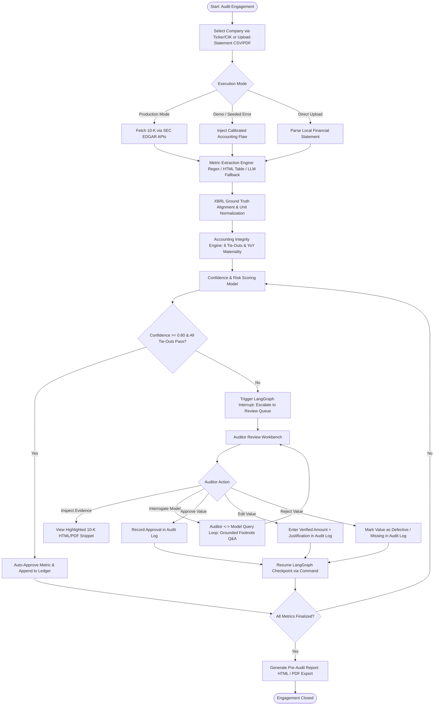
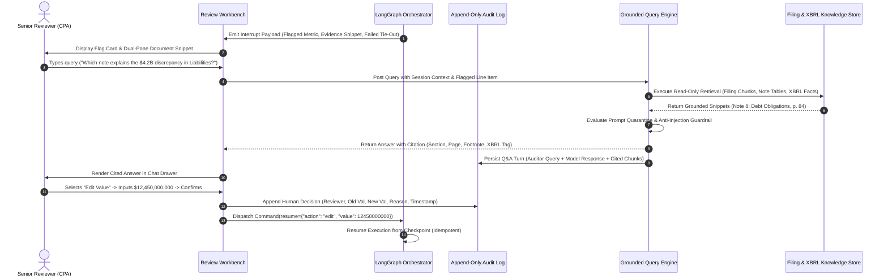

# User Experience Architecture, Flows & Information Architecture

**Author:** Principal Product Designer  
**Product:** Moneta — Human-in-the-Loop Financial Filing Pre-Audit Agent  
**Status:** Approved Specification

---

## 1. User Personas

### Persona A: Pre-Audit Financial Analyst
* **Name:** Alex Rivera
* **Role:** First-Year Assurance Associate / Pre-Audit Analyst
* **Primary Goals:**
  - Quickly ingest 10-K filings or draft client statements.
  - Verify that standard financial statement lines are captured accurately.
  - Inspect highlighted evidence snippets without manually searching through a 150-page PDF/HTML filing.
  - Review preliminary tie-outs ($Assets = Liabilities + Equity$, Net Income to Cash Flow) before senior review.
* **Pain Points:** 
  - Manually transcribing tabular values into audit workpapers takes hours.
  - Missing footnotes or restatements in prior years causes phantom variance calculations.
  - Skeptical of "black-box" AI that cannot cite its work.

### Persona B: Senior Audit Manager / Engagement Lead
* **Name:** Sarah Jenkins, CPA
* **Role:** Audit Manager / Senior Technical Reviewer
* **Primary Goals:**
  - Maintain absolute audit integrity and regulatory compliance (PCAOB/AICPA).
  - Rapidly identify material misstatements, broken accounting links, or anomalous YoY swings.
  - Interrogate flagged discrepancies via a grounded, citation-backed conversational interface.
  - Formally record sign-offs, edits, or rejections into an unalterable, tamper-evident audit trail.
  - Export a finalized, publication-grade Pre-Audit Working Paper Report.
* **Pain Points:**
  - AI hallucinating explanations or making speculative guesses outside of filing disclosures.
  - Alert fatigue from false alarms on immaterial line-item fluctuations.
  - Lack of an immutable paper trail explaining who approved or altered an extracted figure and why.

---

## 2. End-to-End User Journey Flows

### Flow 1: High-Level End-to-End Lifecycle


---

### Flow 2: Auditor <-> Model Query Loop (During Escalation)


---

## 3. Information Architecture & Sitemap

```
Moneta Pre-Audit Application
│
├── / (Ingestion & Engagement Hub)
│   ├── Company Search (Ticker / CIK / Company Name)
│   ├── SEC Filing Selector (Latest 10-K, 10-K/A, Multi-Year)
│   ├── Statement File Uploader (.csv, .pdf drag-and-drop)
│   ├── Demo Mode Selector (Clean Run vs. Seeded Error Scenarios A/B/C)
│   └── Recent Engagements & Checkpoint Resume List
│
├── /audit/:session_id (Pre-Audit Workbench)
│   ├── Global Engagement Header (Entity, CIK, FY, Filing Date, Audit Progress)
│   ├── Executive Status Bar (Extraction Accuracy, Auto-Approved Count, Escalated Count)
│   ├── Primary Financial Statement Ledger (Extracted, XBRL, Variance, Status)
│   ├── Four-Factor Linkage Visualizer (Assets = Liabilities + Equity & P&L Connection)
│   └── Tie-Out Verification Matrix (6 Tie-Out Cards: Pass / Warn / Fail)
│
├── /audit/:session_id/flags/:flag_id (Flagged Exception Drawer / Detail)
│   ├── Flag Summary (Discrepancy Amount, Materiality Assessment, Rule Breached)
│   ├── Dual-Pane Evidence Viewer (Parsed Value vs. Highlighted 10-K Source Snippet)
│   ├── Auditor <-> LLM Q&A Chat Panel (Read-only tools, Grounded Footnote Citations)
│   └── Decision Bar (Approve Extracted / Edit Amount / Reject Metric)
│
├── /audit/:session_id/audit-trail (Immutable Audit History)
│   ├── Chronological Event Log (System Extractions, Validation Checks, Human Decisions)
│   ├── Reviewer Cryptographic Hash / Checkpoint Sign-Off
│   └── Filter by Reviewer, Action Type, or Metric
│
└── /audit/:session_id/report (Pre-Audit Working Paper Report)
    ├── Executive Audit Memorandum
    ├── Four-Factor Linkage Diagram & Roll-Forward Table
    ├── Extraction vs. Ground Truth Accuracy Reconciliation
    ├── Unresolved Exceptions & Auditor Resolution Highlights
    ├── Scope Limitations & Regulatory Disclaimers
    └── Export Actions (Download Formal PDF / Print / Export HTML)
```

---

## 4. Screen Inventory & State Machine

| Screen | State | Visual Representation & User Affordance |
| :--- | :--- | :--- |
| **Ingestion Hub** | `Empty` | Search input with quick-select pills for benchmark filings (AAPL, MSFT, TSLA, IBM) and a dashed dropzone for file upload. |
| | `Loading` | Submissions fetch indicator; SEC rate-limit throttle countdown (if applicable); skeleton search results. |
| | `Error` | Clear error banner: "Entity not found in EDGAR" or "Invalid SEC User-Agent declaration". Actionable retry button. |
| **Workbench** | `Processing` | Multi-step progress timeline: [1/5 Fetching] -> [2/5 Parsing] -> [3/5 XBRL Match] -> [4/5 Tie-Outs] -> [5/5 Scoring]. |
| | `Active Review` | Split-view: Left side shows Financial Statement Ledger with color-coded confidence pills; Right side shows pending escalation queue. |
| | `Flagged` | Red/Ochre highlight on affected statement row; pulsating badge on Flagged Queue tab; click immediately opens flag drawer. |
| | `All Resolved` | Status updates to "Pre-Audit Complete. 100% metrics finalized." Prominent button: "Generate Working Paper Report". |
| **Flag Drawer** | `Open / Reviewing` | Slide-over drawer (45% viewport width). Header with failed tie-out delta; center shows highlighted 10-K snippet; bottom has action buttons. |
| | `Q&A Querying` | Inline chat thread within drawer. Subtle loading pulse with label: "Searching filing disclosures and XBRL tags...". |
| | `Decided` | Action buttons disable; green confirmation banner shows recorded decision with reviewer name and timestamp; drawer closes gracefully. |
| **Report View** | `Draft` | Interactive HTML preview of formal audit memorandum with watermarked "PRE-AUDIT WORKING PAPER — DRAFT". |
| | `Final` | Exportable PDF and printable HTML with formal signature block, clean pagination, and complete audit trail appendix. |

